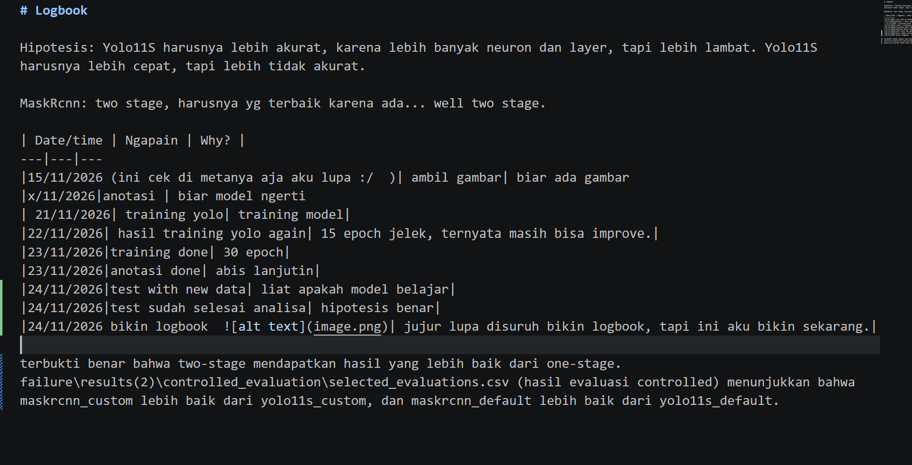

# Logbook 

Hipotesis: Yolo11S harusnya lebih akurat, karena lebih banyak neuron dan layer, tapi lebih lambat. Yolo11S harusnya lebih cepat, tapi lebih tidak akurat.

MaskRcnn: two stage, harusnya yg terbaik karena ada... well two stage. 

| Date/time | Ngapain | Why? |
---|---|---
|15/11/2026 (ini cek di metanya aja aku lupa :/  )| ambil gambar| biar ada gambar
|x/11/2026|anotasi | biar model ngerti
| 21/11/2026| training yolo| training model|
|22/11/2026| hasil training yolo again| 15 epoch jelek, ternyata masih bisa improve.|
|23/11/2026|training done| 30 epoch|
|23/11/2026|anotasi done| abis lanjutin|
|24/11/2026|test with new data| liat apakah model belajar|
|24/11/2026|test sudah selesai analisa| hipotesis benar|
|24/11/2026 bikin logbook  | jujur lupa disuruh bikin logbook, tapi ini aku bikin sekarang.|

terbukti benar bahwa two-stage mendapatkan hasil yang lebih baik dari one-stage.
failure\results(2)\controlled_evaluation\selected_evaluations.csv (hasil evaluasi controlled) menunjukkan bahwa maskrcnn_custom lebih baik dari yolo11s_custom, dan maskrcnn_default lebih baik dari yolo11s_default.